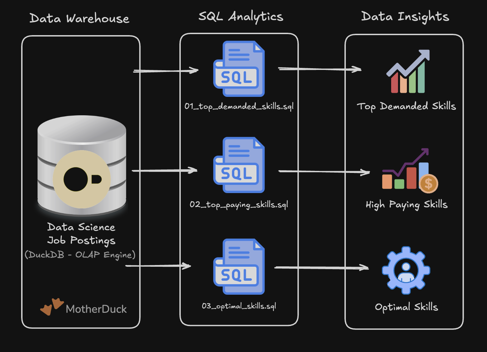
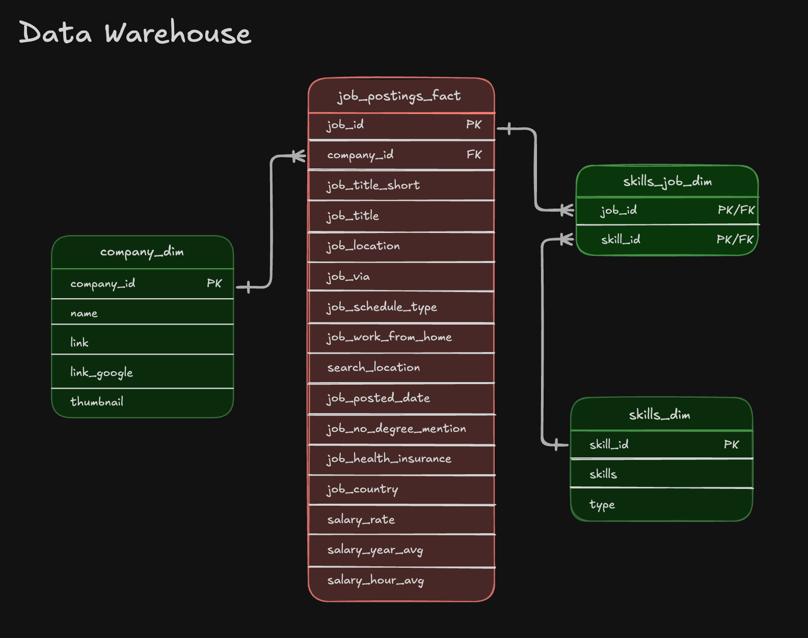

# Exploratory Data Analysis w/ SQL: Job Market Analysis

An end-to-end SQL analysis of the **data engineer job market**, built on a **star schema data warehouse** hosted in **MotherDuck** and queried with **DuckDB**. The project shows how I **model and query relational data, write clean analytical SQL, and turn business questions into measurable, data-driven answers**, which are core skills in data engineering work.

## Executive Summary

- ✅ **Project scope:** Designed and wrote **3 analytical SQL queries** answering key business questions about skill demand and salaries for data engineers
- ✅ **Data modeling:** Queried a **star schema** with **multi-table joins** across fact, bridge, and dimension tables, resolving a many-to-many relationship between job postings and skills
- ✅ **Analytics:** Applied **aggregations, filtering, sorting, `HAVING` thresholds, and a log-scaled scoring metric** to rank skills by demand, salary, and overall value
- ✅ **Outcomes:** Delivered **concrete, numbers-based insights** on SQL/Python dominance, cloud platform demand, and which infrastructure skills pay a premium

If you only have a minute, review these:

1. [`01_top_demanded_skills.sql`](./01_top_demanded_skills.sql) – demand analysis with multi-table joins
2. [`02_top_paying_skills.sql`](./02_top_paying_skills.sql) – salary analysis with aggregations
3. [`03_optimal_skills.sql`](./03_optimal_skills.sql) – combined demand/salary optimization query

## Problem & Context

Job seekers, recruiters, and hiring managers all need answers to the same questions:

- 🎯 **Most in-demand:** *Which skills are most in-demand for data engineers?*
- 💰 **Highest paid:** *Which skills command the highest salaries?*
- ⚖️ **Best trade-off:** *What is the optimal skill set balancing demand and compensation?*

To answer them, I queried a **data warehouse designed as a star schema**:

- **Fact Table:** `job_postings_fact` – central table with job posting details (job titles, locations, salaries, dates, remote flag, etc.)
- **Dimension Tables:**
  - `company_dim` – company information linked to job postings
  - `skills_dim` – skills catalog with skill names and types
- **Bridge Table:** `skills_job_dim` – resolves the many-to-many relationship between job postings and skills

Joining the fact table through the bridge table to the skills dimension made it possible to measure **demand and salary per skill**, which is the basis for every query in this project.

## Tech Stack

- 🐤 **Query Engine:** DuckDB, a columnar engine built for fast OLAP-style analytical queries, connected to a MotherDuck cloud data warehouse
- 🧮 **Language:** SQL (ANSI-style with aggregate and mathematical functions)
- 📊 **Data Model:** Star schema with fact, dimension, and bridge tables
- 🛠️ **Development:** VS Code for writing SQL + terminal for running queries in the DuckDB CLI
- 📦 **Version Control:** Git/GitHub for versioned SQL scripts

## Analysis Overview

### Query Structure

1. **[Top Demanded Skills](./01_top_demanded_skills.sql)** – Identifies the 10 most in-demand skills for remote data engineer positions
2. **[Top Paying Skills](./02_top_paying_skills.sql)** – Analyzes the 25 highest-paying skills with median salary and demand count
3. **[Optimal Skills](./03_optimal_skills.sql)** – Calculates an optimal score that combines median salary with the natural log of demand, so that very common skills do not dominate and rare skills with few postings do not distort the ranking

### Key Insights

- 🧠 **Core languages:** SQL and Python each appear in ~29,000 remote job postings, nearly double any other skill, which confirms them as the foundation of data engineering
- ☁️ **Cloud platforms:** AWS (~18,000 postings) and Azure (~14,000) are the most requested platforms, so cloud experience is a standard requirement in modern data engineering roles
- 🧱 **Infra & tooling:** Infrastructure skills pay a premium: Terraform has a **$184K** median salary and ranks **#1 in the optimal score**, and Kubernetes reaches **$150.5K**
- 🔥 **Big data tools:** Apache Spark (~13,000 postings) and Airflow ($150K median) combine strong demand with competitive pay

## SQL Skills Demonstrated

### Query Design & Optimization

- **Complex Joins:** Multi-table `INNER JOIN` operations across `job_postings_fact`, `skills_job_dim`, and `skills_dim`
- **Aggregations:** `COUNT()`, `MEDIAN()`, `ROUND()` for statistical analysis
- **Filtering:** Boolean logic in `WHERE` clauses with multiple conditions (`job_title_short`, `job_work_from_home`, `salary_year_avg IS NOT NULL`)
- **Sorting & Limiting:** `ORDER BY` with `DESC` and `LIMIT` for top-N analysis

### Data Analysis Techniques

- **Grouping:** `GROUP BY` for categorical analysis by skill
- **Conditional Logic:** `CASE WHEN` statements for derived metrics
- **Mathematical Functions:** `LN()` for natural log transformation to normalize demand
- **Calculated Metrics:** A custom optimal score combining log-transformed demand with median salary
- **HAVING Clause:** Filtering aggregated results (skills with >= 100 postings) to remove statistically unreliable outliers
- **NULL Handling:** Excluding incomplete records (`salary_year_avg IS NOT NULL`) so salary statistics stay accurate