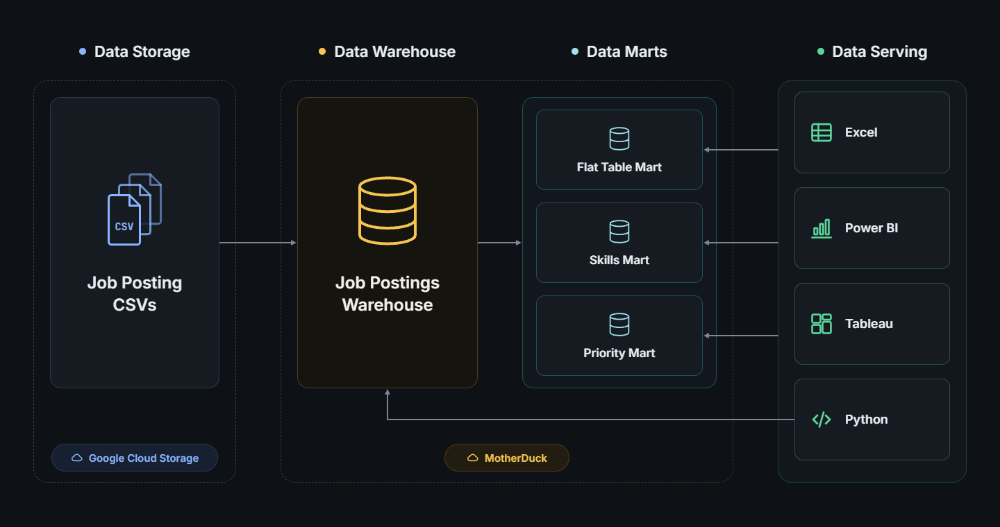
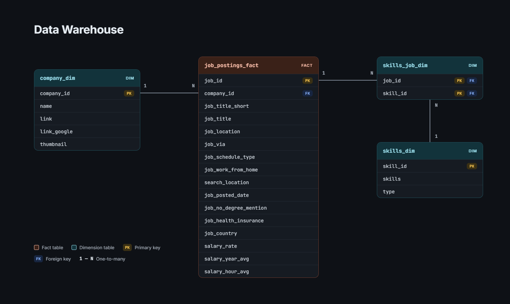
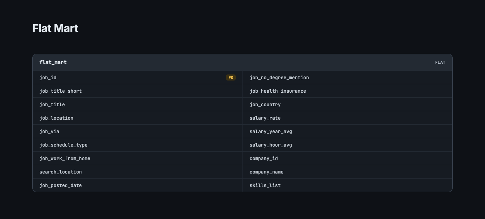
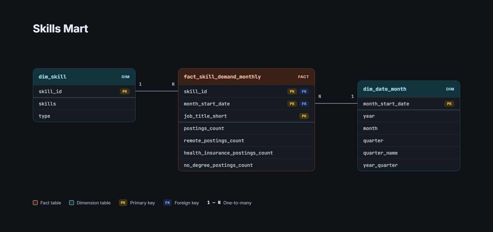
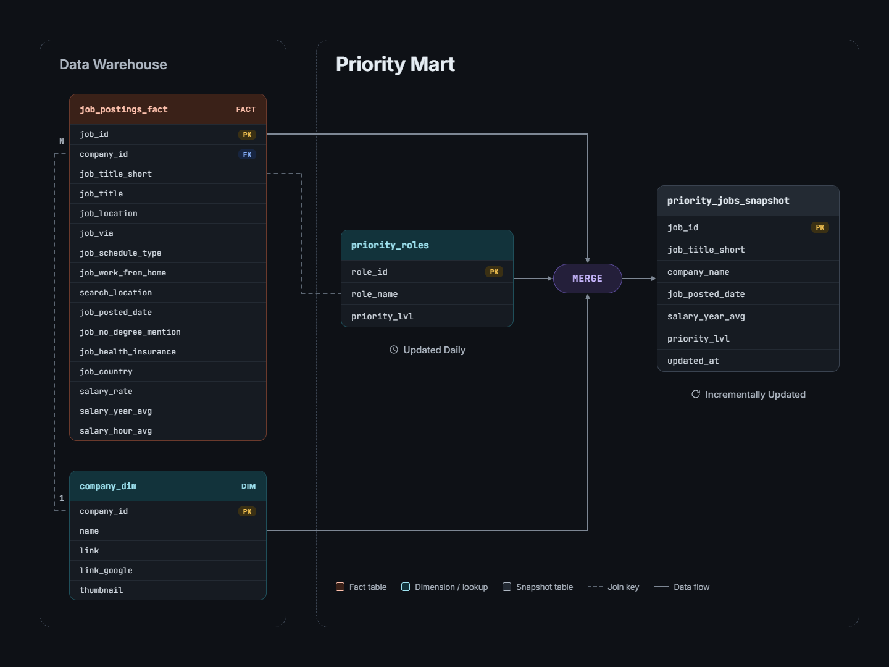

# 🏗️ Data Warehouse & Mart Build: Production ETL Pipeline

An end-to-end data engineering pipeline that **extracts raw CSV files from Google Cloud Storage**, **loads them into a normalized star schema data warehouse**, and **builds analytical data marts** for specific business use cases. Written entirely in SQL and run on DuckDB, the project covers the full data engineering lifecycle: **ingestion, dimensional modeling, transformation, incremental updates, and orchestration**.

## Executive Summary

- ✅ **Pipeline scope:** Built a complete **ETL pipeline** that moves data from raw CSV files in cloud storage, through a star schema warehouse, into analytical data marts
- ✅ **Data modeling:** Designed a **star schema** with a fact table, dimension tables, and bridge tables that handle many-to-many relationships
- ✅ **ETL development:** Implemented **extract, transform, and load** steps that are **idempotent** (safe to rerun) and include **data quality checks** at each stage
- ✅ **Mart architecture:** Created **specialized data marts** (flat, skills, priority) with **additive measures** and **incremental updates via `MERGE`**

## Problem & Context

**Challenge:** Data teams need a **single source of truth**, a data warehouse, so that analysis across the organization is consistent and reliable. On top of that, they need **data marts**: smaller, pre-aggregated tables built for specific business questions. Marts reduce query complexity, lower compute costs, and speed up the most common analyses.

**Solution:** An end-to-end ETL pipeline that extracts CSV files from cloud storage, normalizes them into a star schema warehouse (separating facts from dimensions), and builds specialized data marts for specific use cases: ad-hoc flat queries, skill demand analysis over time, and priority role tracking.

## Tech Stack

- 🐤 **Database:** DuckDB, a file-based OLAP database, reading directly from Google Cloud Storage via the `httpfs` extension
- 🧮 **Language:** SQL – DDL for schema design, DML for loading and transforming data
- 📊 **Data Model:** Star schema (fact, dimension, and bridge tables)
- 🛠️ **Development:** VS Code for writing SQL + terminal for running scripts in the DuckDB CLI
- 🔧 **Automation:** A master SQL script that runs the whole pipeline in the correct order
- 📦 **Version Control:** Git/GitHub for versioned pipeline scripts
- ☁️ **Storage:** Google Cloud Storage as the source of raw CSV files

## 🏗️ Pipeline Architecture

Raw job posting CSV files are extracted from Google Cloud Storage, transformed into a normalized star schema data warehouse, and then reshaped into specialized data marts. Downstream BI and analytics tools (Excel, Power BI, Tableau, Python) can read from both the warehouse and the marts, depending on the use case.

### Data Warehouse

The warehouse is the core layer of the pipeline. It follows a star schema made up of `company_dim`, `skills_dim`, `job_postings_fact`, and `skills_job_dim`.

- **SQL Files:**
  - [`01_create_tables_dw.sql`](./01_create_tables_dw.sql) – Defines the star schema with 4 core tables
  - [`02_load_schema_dw.sql`](./02_load_schema_dw.sql) – Extracts CSV files from GCS and loads them into the warehouse tables
- **Purpose:** A normalized star schema that serves as the single source of truth for all analysis
- **Grain:** One row per job posting in the fact table (`job_postings_fact`)

### Flat Mart

A denormalized table that joins all dimensions together for fast, simple ad-hoc queries.

- **SQL File:** [`03_create_flat_mart.sql`](./03_create_flat_mart.sql) – Builds a denormalized table with all dimensions joined
- **Purpose:** Lets analysts query everything from one table, without writing joins
- **Grain:** One row per job posting, with all dimension attributes included

### Skills Mart

A time-series mart for tracking skill demand month by month, built with additive measures.

- **SQL File:** [`04_create_skills_mart.sql`](./04_create_skills_mart.sql) – Builds the time-series skill demand mart
- **Purpose:** Analyze how demand for each skill changes over time
- **Grain:** `skill_id + month_start_date + job_title_short`
- **Key Features:** All measures are additive (counts and sums), so they can be safely re-aggregated to any level, e.g. from month to quarter or from job title to all roles

### Priority Mart

A mart for tracking priority roles, kept up to date with incremental `MERGE` operations instead of full reloads.

- **SQL Files:**
  - [`05_create_priority_mart.sql`](./05_create_priority_mart.sql) – Initial build of the priority roles table and job snapshot
  - [`06_update_priority_mart.sql`](./06_update_priority_mart.sql) – **Incremental update using `MERGE`** (upsert pattern)
- **Purpose:** Track priority roles and their job postings, with support for incremental updates
- **Grain:** One row per job posting, with an assigned priority level
- **Key Features:** **`MERGE` handles inserts, updates, and deletes in a single statement**, the same upsert pattern used in production pipelines to process only changed data

## Data Engineering Skills Demonstrated

### ETL Pipeline Development

- **Extract:** Loading CSV files directly from Google Cloud Storage with DuckDB's `httpfs` extension
- **Transform:** Normalizing data, converting types (`CAST`, `DATE_TRUNC`), and filtering out low-quality records
- **Load:** Idempotent table creation with `DROP TABLE IF EXISTS`, so every run starts from a clean state
- **Incremental Updates:** `MERGE` for upserts (insert, update, and delete in a single statement)
- **Orchestration:** A master SQL script (`build_dw_marts.sql`) that runs the full pipeline end to end

### Dimensional Modeling

- **Star Schema Design:** A fact table (`job_postings_fact`) surrounded by dimension tables (`company_dim`, `skills_dim`)
- **Bridge Tables:** Handling the many-to-many relationship between job postings and skills (`skills_job_dim`)
- **Grain Definition:** Clearly defined granularity for every table (e.g. one row per job posting, skill + month + job title)
- **Additive Measures:** Counts and sums that can be safely re-aggregated at any level

### SQL Advanced Techniques

- **DDL Operations:** `CREATE TABLE`, `DROP TABLE`, and `CREATE SCHEMA` for managing schemas
- **DML Operations:** `INSERT INTO ... SELECT` with explicit column mapping from CSV sources
- **MERGE Operations:** Incremental updates with `MERGE INTO` using `WHEN MATCHED`, `WHEN NOT MATCHED`, and `WHEN NOT MATCHED BY SOURCE` clauses
- **CTEs:** Common Table Expressions for multi-step transformations and boolean flag conversions
- **Date Functions:** `DATE_TRUNC('month')` and `EXTRACT(quarter)` for building time dimensions
- **String Functions:** `STRING_AGG` for concatenation and `REPLACE` for data cleaning
- **Boolean Logic:** `CASE WHEN` to convert flags (remote work, health insurance, no degree required) into countable measures

### Data Quality & Production Practices

- **Idempotency:** Every script can be rerun safely without duplicating or corrupting data
- **Data Validation:** Verification queries after each pipeline step to confirm data integrity
- **Type Safety:** Explicit data types (`VARCHAR`, `INTEGER`, `DOUBLE`, `BOOLEAN`, `TIMESTAMP`) for every column
- **Schema Organization:** Separate schemas (`flat_mart`, `skills_mart`, `priority_mart`) to keep each mart logically isolated
- **Error Handling:** Structured script execution with clear error messages and progress reporting
