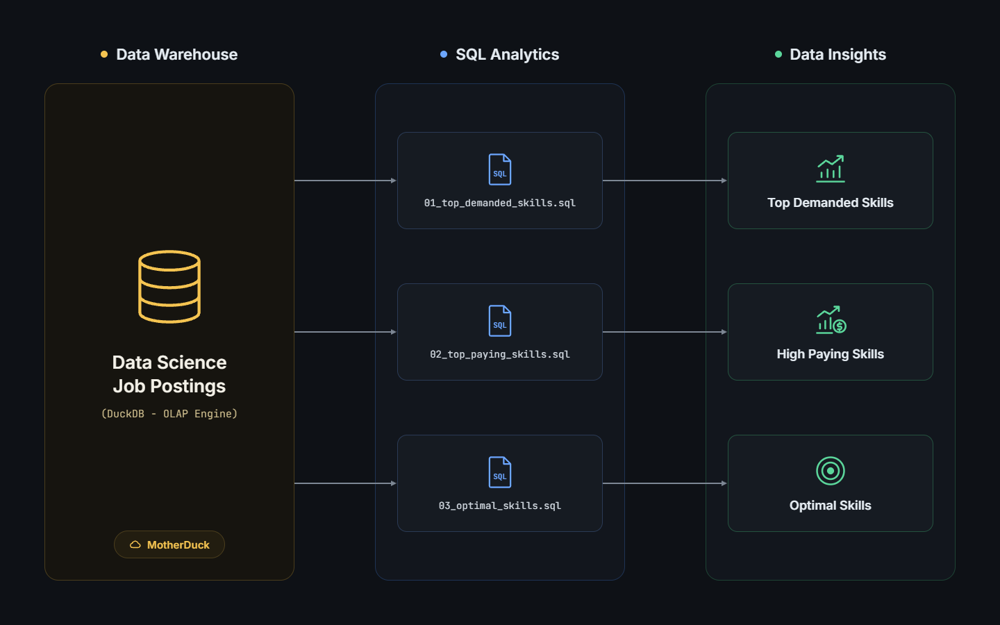
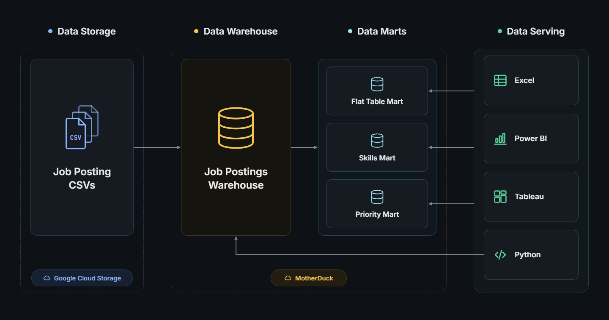

# SQL Data Engineering Projects

A collection of SQL projects I built to practice and strengthen my data engineering skills, from analytical querying to building a full ETL pipeline with a star schema data warehouse and data marts.

> Click a project name below to see the details, tools, and SQL code behind it.

*Inspired by Luke Barousse's **SQL for Data Engineering** course.*

## Projects

### [1. EDA](/1_EDA/) - Exploratory Data Analysis

SQL analysis of the data engineer job market, identifying the most in-demand skills, the highest-paying skills, and the skills that offer the best balance between demand and salary.

**Skills**: Multi-table joins, aggregations, star schema querying, analytical metrics, data-driven insights

### [2. DW & Mart Build](/2_DW_Mart_Build/) - Data Pipeline - Data Warehouse & Mart

End-to-end ETL pipeline that loads raw CSV files from Google Cloud Storage into a star schema data warehouse and builds analytical data marts, including incremental updates with `MERGE`.

**Skills**: Dimensional modeling, ETL pipeline development, data mart architecture, production practices
